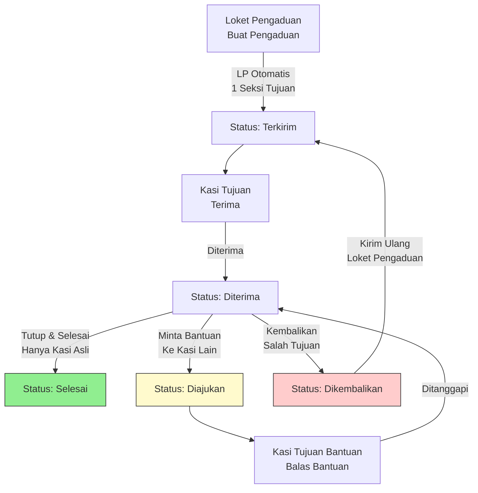

# Alur Pengaduan Masyarakat (Tiket LP)

> **Dokumen Resmi Berdasarkan Kode Implementasi Aktual**  
> Sistem: SAPA Balam (Laravel 13 · PHP 8.3 · MySQL · Blade)  
> Satuan Kerja: Kantor Pertanahan Kota Bandar Lampung (BALAM)  
> Status: Revisi saat ini (tidak mencakup Super Admin)

---

## 1. Ringkasan Alur Singkat

```
Loket Pengaduan (Buat Pengaduan → LP Otomatis)
    ↓ (status: terkirim, 1 Seksi tujuan saja)
Kasi Tujuan (Terima → diterima)
    ↓
[Opsi A] Tutup & Selesai (hanya Kasi asli) → selesai
[Opsi B] Minta Bantuan ke Kasi Lain → balasan → kembali ke Kasi asli
    ↓ (berulang bebas, tanpa batas)
Selesai Akhir (hanya Kasi asli yang boleh klik)
```

---

## 2. Detail Alur Pengaduan

### Tahap A: Loket Pengaduan — Buat Pengaduan

| Langkah | Aksi | Detail |
|---------|------|--------|
| 1 | Buka menu **Buat Pengaduan** | `pengaduan.create` |
| 2 | Isi No Tiket Pengaduan (LP) — otomatis: `LP{ddmmyyyy}{urut}` | Read-only |
| 3 | Pilih **Kategori** (Permasalahan Tanah / Pungli / Pelayanan / Lainnya) | Wajib |
| 4 | Pilih **Seksi Tujuan** (1–5 atau TU) — hanya 1 unit | Wajib |
| 5 | Isi **Identitas Pengadu** (Nama, NIK, No HP, Alamat; anonim boleh dikosongkan) | Wajib (bukan anonim) |
| 6 | Jika Kategori = Permasalahan Tanah: isi Detail Surat Formal (Hal, Bertindak Untuk, Kuasa, Letak, Luas, Status Tanah, Pokok Masalah, Kategori/Kelompok Aduan, Uraian Singkat, Lampiran) | Wajib |
| 7 | Isi **Catatan/Uraian Pengaduan** (min 20 karakter) | Wajib |
| 8 | Klik **KIRIM PENGADUAN** → status `terkirim` | `pengaduan.store` (POST) |

- **No LP**: Otomatis, tidak bisa diubah, reset urutan setiap hari
- **Catatan kronologis**: Disimpan di `pengaduan_catatans` dengan `urutan` (1, 2, 3...)
- **Riwayat status**: Disimpan di `pengaduan_riwayats`

---

### Tahap B: Kasi Tujuan Menerima Pengaduan

| Aktor | Menu | Aksi | Route |
|-------|------|------|-------|
| Kasi Seksi 1/2/3/4/5, Kasubbag TU | `pengaduan-unit.index` | Lihat pengaduan ditujukan ke unitnya | `pengaduan-unit.index` |
| | | Klik **Terima** → status `diterima` | `pengaduan-unit.terima` (POST) |
| | | Atau **Kembalikan** ke Loket (salah tujuan) | `pengaduan-unit.kembalikan` (POST) |

- **Kasi Seksi 1 dan 2**: Bisa melihat permohonan (tiket) DAN pengaduan
- **Kasi Seksi 3, 4, 5 dan Kasubbag TU**: Hanya melihat **pengaduan**, tidak ada modul permohonan/tiket
- Notifikasi otomatis ke pembuat saat diterima

---

### Tahap C: Kasi Asli Meminta Bantuan (Opsional, Berulang Bebas)

Hanya **Kasi asli** (`seksi_tujuan` dari Loket) yang boleh meminta bantuan.

| Langkah | Aksi | Route |
|---------|------|-------|
| 1 | Kasi asli sudah **Terima** pengaduan (`diterima`) | — |
| 2 | Klik **Minta Bantuan** → pilih 1 Kasi lain, isi catatan permintaan | `pengaduan-unit.minta-bantuan` (POST) |
| 3 | Tabel `pengaduan_bantuans`: `dari_kasi` → `ke_kasi`, status `diajukan` | — |
| 4 | Catatan kronologis: jenis `minta_bantuan` | `pengaduan_catatans` |
| 5 | Notifikasi ke Kasi tujuan bantuan | Notifikasi in-app |

**Aturan:**
- Hanya 1 Kasi tujuan bantuan setiap kali minta bantuan
- Bisa minta bantuan ke Kasi yang sama atau berbeda berulang kali
- Tidak ada batas maksimal pengulangan
- Status pengaduan tetap `diterima` (proses), belum `selesai`

---

### Tahap D: Kasi Tujuan Bantuan Membalas

| Langkah | Aksi | Route |
|---------|------|-------|
| 1 | Kasi tujuan bantuan melihat permintaan bantuan yang menunggu | `pengaduan-unit.show` |
| 2 | Klik **Balas Bantuan** → isi catatan balasan | `pengaduan-unit.balas-bantuan` (POST) |
| 3 | Tabel `pengaduan_bantuans`: `catatan_ke` diisi, status `ditanggapi` | — |
| 4 | Catatan kronologis: jenis `balasan_bantuan` | `pengaduan_catatans` |
| 5 | Notifikasi ke Kasi asli (peminta bantuan) | Notifikasi in-app |

**Transparansi:** Semua catatan dari Loket dan semua Kasi dalam rantai bantuan terlihat oleh semua Kasi yang terlibat. Kasi yang bukan target sama sekali tidak melihat pengaduan tersebut.

---

### Tahap E: Selesai Akhir (Hanya Kasi Asli)

| Langkah | Aksi | Route |
|---------|------|-------|
| 1 | Kasi asli (`seksi_tujuan`) buka detail pengaduan | `pengaduan-unit.show` |
| 2 | Klik **Tutup (Selesai Akhir)** → isi catatan hasil (min 10 karakter) | `pengaduan-unit.tutup` (POST) |
| 3 | Status berubah `selesai`, catatan tersimpan | `PengaduanUnitController@tutup` |
| 4 | Notifikasi ke pembuat pengaduan | Notifikasi in-app |

**Aturan:**
- Hanya Kasi asli (`seksi_tujuan`) yang boleh klik Selesai Akhir
- Kasi tujuan bantuan **tidak boleh** klik Selesai
- Jika masih ada alur bantuan (belum ditanggapi), status tetap `diterima` (proses)

---

### Tahap F: Kirim Ulang (Jika Dikembalikan)

| Langkah | Aksi | Route |
|---------|------|-------|
| 1 | Kasi mengembalikan pengaduan (salah tujuan) → status `dikembalikan` | `pengaduan-unit.kembalikan` |
| 2 | Loket Pengaduan buka detail, klik **Kirim Ulang** | `pengaduan.kirim-ulang` (POST) |
| 3 | Pilih Seksi Tujuan baru, isi catatan perbaikan | — |
| 4 | Status kembali `terkirim`, Nomor LP tidak berubah | — |

---

## 3. Diagram Alur Pengaduan



---

## 4. Matriks Role dalam Alur Pengaduan

| Role | Lihat Pengaduan | Terima | Tutup/Selesai | Minta Bantuan | Balas Bantuan | Kembalikan |
|------|-----------------|--------|---------------|---------------|---------------|------------|
| Kasi Seksi 1 | ✅ (Seksi 1) | ✅ | ✅ (asli) | ✅ (asli) | ✅ (tujuan) | ✅ |
| Kasi Seksi 2 | ✅ (Seksi 2) | ✅ | ✅ (asli) | ✅ (asli) | ✅ (tujuan) | ✅ |
| Kasi Seksi 3 | ✅ (Seksi 3) | ✅ | ✅ (asli) | ✅ (asli) | ✅ (tujuan) | ✅ |
| Kasi Seksi 4 | ✅ (Seksi 4) | ✅ | ✅ (asli) | ✅ (asli) | ✅ (tujuan) | ✅ |
| Kasi Seksi 5 | ✅ (Seksi 5) | ✅ | ✅ (asli) | ✅ (asli) | ✅ (tujuan) | ✅ |
| Kasubbag TU | ✅ (TU) | ✅ | ✅ (asli) | ✅ (asli) | ✅ (tujuan) | ✅ |
| Loket Pengaduan | ✅ (milik sendiri) | ❌ | ❌ | ❌ | ❌ | ❌ |
| Admin | ✅ (semua) | ✅ | ✅ | ✅ | ✅ | ✅ |
| Kakan | ✅ (monitoring) | ❌ | ❌ | ❌ | ❌ | ❌ |

---

## 5. Keterbatasan & Aturan Penting

1. **1 Seksi Tujuan saja** dari Loket Pengaduan (bukan multi)
2. **Hanya Kasi asli** yang boleh klik Tutup (Selesai Akhir)
3. **Bantuan antar Kasi** bebas berulang, tanpa batas maksimal
4. **Semua catatan transparan** untuk semua Kasi dalam rantai bantuan
5. **Kasi non-target** tidak melihat pengaduan sama sekali
6. **Kasi Seksi 3, 4, 5 dan Kasubbag TU** tidak melihat modul permohonan/tiket — hanya pengaduan
7. Status tetap `diterima` (proses) selama ada alur bantuan, baru `selesai` saat Kasi asli klik Selesai

---

## 6. Tabel Database Terkait

| Tabel | Keterangan |
|-------|------------|
| `pengaduans` | Data utama pengaduan (nomor LP, seksi_tujuan, status, catatan_terakhir) |
| `pengaduan_riwayats` | Riwayat perubahan status (terkirim → diterima → selesai/dikembalikan) |
| `pengaduan_catatans` | Catatan kronologis dari Loket dan semua Kasi (urutan 1, 2, 3...) |
| `pengaduan_bantuans` | Rantai bantuan antar Kasi (dari_kasi → ke_kasi, catatan_dari → catatan_ke) |

---

## Catatan Penting

- **Super Admin tidak termasuk** dalam dokumentasi alur operasional ini
- **Kasi Seksi 1 dan 2** additionally bisa melihat daftar permohonan/tiket (modul Seksi)
- **Kasi Seksi 3, 4, 5 dan Kasubbag TU** hanya modul pengaduan, tidak ada tiket permohonan
