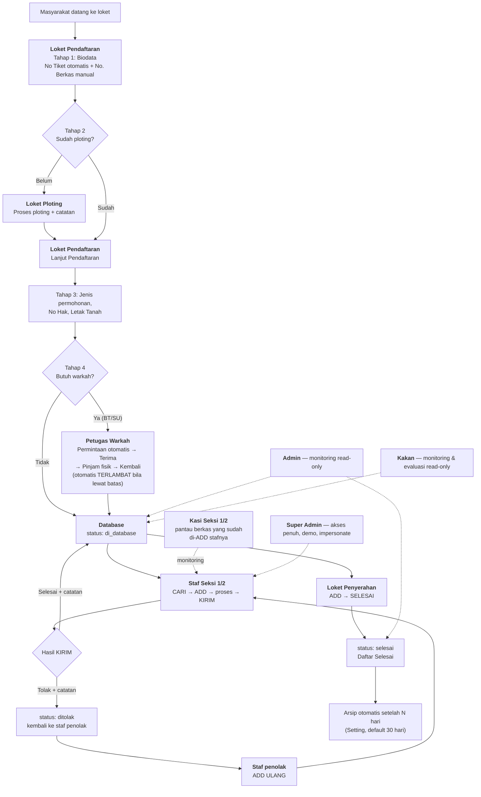
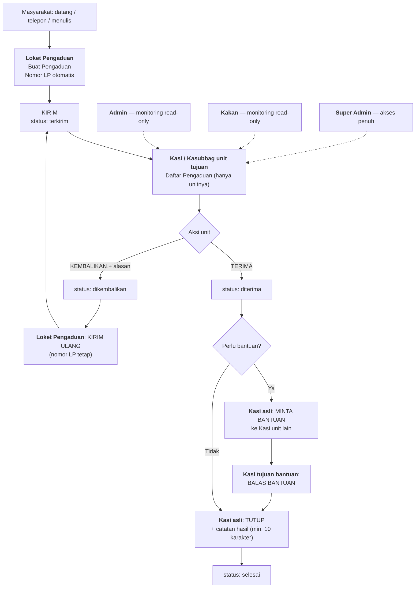

# SAPA Balam

## Laporan Teknologi & Profil Sistem

Sistem pelayanan berkas permohonan dan pengaduan pertanahan untuk
**Kantah BPN Kota Bandar Lampung**. Aplikasi mencatat perjalanan berkas
sejak pendaftaran di loket, proses back office, hingga penyerahan kepada
pemohon, termasuk pengelolaan warkah fisik dan pengaduan masyarakat.

> Dokumen ini menjelaskan profil, arsitektur, teknologi, modul, serta peran
> dan aturan akses. Dokumen **tidak memuat** kredensial akun, isi konfigurasi
> lingkungan, token, dump database, atau lokasi berkas cadangan.

---

## 1. Profil Singkat

| Aspek | Keterangan |
|---|---|
| Nama sistem | SAPA Balam |
| Instansi | Kantah BPN Kota Bandar Lampung |
| Jenis | Aplikasi web internal |
| Fungsi utama | Pelacakan alur berkas & pengaduan |
| Pengguna | Petugas loket, staf seksi, kasi, pimpinan, admin |
| Akses | Berbasis peran (RBAC) dan seksi |
| Notifikasi | In-app (tanpa email/WhatsApp/SMS) |

---

## 2. Tujuan & Ruang Lingkup

- Menertibkan alur berkas dari pendaftaran sampai penyerahan.
- Memberi visibilitas status berkas kepada petugas dan pimpinan.
- Mencatat riwayat perpindahan berkas dan aktivitas pengguna.
- Mengelola warkah fisik (Buku Tanah / Surat Ukur).
- Menangani pengaduan masyarakat secara terstruktur.
- Menyediakan monitoring read-only bagi Admin dan Kakan.

---

## 3. Arsitektur Aplikasi

Aplikasi menggunakan pola **MVC** Laravel dengan lapisan service:

```text
Request
  → Route
  → Middleware (auth, role, super_admin, impersonate, CSRF)
  → Controller
  → Service (notifikasi, penomoran, log aktivitas)
  → Model / Database
  → Blade View
```

Komponen penting:

- **Controller** mengatur alur tiap modul.
- **Service** memisahkan logika lintas modul (notifikasi, penomoran tiket, log aktivitas).
- **Middleware** menegakkan RBAC dan pembatasan Admin.
- **Blade** merender antarmuka; CSS/JS utama dimuat dari CDN (Bootstrap, Bootstrap Icons, Chart.js) sehingga tidak memerlukan proses build.
- **Scheduler** menjalankan arsip otomatis dan pengingat harian.

---

## 4. Tumpukan Teknologi

| Lapisan | Teknologi | Versi |
|---|---|---|
| Bahasa | PHP | 8.3 |
| Framework | Laravel | 13.x |
| Database | MySQL | 8.x |
| Antarmuka | Blade + Bootstrap | 5.3.3 |
| Ikon | Bootstrap Icons | 1.11.3 |
| Grafik | Chart.js | 4.4.4 |
| Pemuatan aset | CDN (tanpa build) | — |
| PDF | DomPDF | 3.1 |
| API token | Laravel Sanctum | 4.0 |
| Pengujian | PHPUnit | 12.5 |
| Formatter | Laravel Pint | 1.27 |

Catatan: antarmuka menggunakan Blade + Bootstrap yang dimuat dari CDN.
Vite tetap tersedia di repositori, tetapi **tidak wajib** dijalankan untuk
menjalankan aplikasi (tidak ada `@vite` pada view).

---

## 5. Modul Fungsional

| Modul | Fungsi |
|---|---|
| Autentikasi | Login, logout, profil, ubah password |
| Pendaftaran | Wizard 4 tahap, nomor tiket otomatis, No. Berkas manual |
| Ploting | Antrean dan proses pemetaan bidang |
| Back Office Seksi 1/2 | Cari → ADD → proses → KIRIM (Selesai/Tolak), ADD ULANG |
| Warkah | Permintaan otomatis, pinjam fisik, batas kembali, penanda terlambat |
| Penyerahan | Antrean penyerahan, serah terima, status selesai |
| Pengaduan | Registrasi LP, kirim ke unit, terima, bantuan antar-kasi, tutup |
| Notifikasi | Lonceng in-app, preferensi per tipe, notifikasi wajib |
| Arsip | Arsip otomatis setelah N hari dan pengelolaan folder arsip |
| Monitoring Admin | Berkas, berkas selesai, pengaduan (read-only) |
| Manajemen | Akun, form pendaftaran, master data, setting, log aktivitas |
| Pimpinan | Monitoring dan evaluasi read-only |
| Super Admin | Demo, impersonate, backup, log |

---

## 6. Alur Permohonan

Alur utama berkas permohonan: dari pendaftaran di loket sampai penyerahan
kepada pemohon, lalu arsip otomatis.



### 6.1 Peran dalam Alur Permohonan

| Role | Keterlibatan | Aturan |
|---|---|---|
| `loket_pendaftaran` | Tahap 1–4, cetak antrian, lanjut pendaftaran | Hanya berkas yang ia daftarkan; No Tiket otomatis tidak bisa diubah |
| `loket_ploting` | Proses antrean ploting | Tidak mendaftarkan berkas; hanya ploting + catatan |
| `petugas_warkah` | Permintaan warkah, pinjam & kembali fisik | Tidak memproses permohonan; hanya sirkulasi warkah |
| `staf_seksi` (Seksi 1/2) | ADD, proses, KIRIM Selesai/Tolak, ADD ULANG | Hanya berkas di seksinya; ADD ULANG hanya oleh staf penolak |
| `kasi_seksi` (Seksi 1/2) | Monitoring berkas seksinya | Tidak boleh ADD/KIRIM; hanya melihat setelah staf ADD |
| `loket_penyerahan` | ADD → SELESAI | Satu-satunya penutup alur; tidak bisa Tolak |
| `admin` | Monitoring berkas & selesai | **Read-only**, tidak bisa ADD/Tolak/Arsip manual |
| `kakan` | Monitoring & evaluasi | Read-only seluruh unit |
| `super_admin` | Akses penuh, demo, impersonate | Sesi impersonate read-only |

### 6.2 Aturan Transisi (Permohonan)

| Dari | Ke | Aksi | Aturan |
|---|---|---|---|
| — | `di_database` | Tahap 4 selesai | Warkah dibuat otomatis bila perlu |
| `di_database` | `diproses` | ADD | Satu tiket satu akun per stasiun |
| `diproses` | `di_database` | KIRIM → Selesai | Wajib catatan |
| `diproses` | `ditolak` | KIRIM → Tolak | Wajib catatan; `penanggung_jawab = user` |
| `ditolak` | `diproses` | ADD ULANG | Hanya staf penolak |
| `diproses` | `selesai` | SELESAI (Loket Penyerahan) | Satu-satunya aksi penutup |
| `selesai` | arsip | Otomatis | Setelah N hari (default 30) |

---

## 7. Alur Pengaduan

Alur pengaduan masyarakat: dibuat di Loket Pengaduan, ditangani Kasi unit
tujuan, dengan cabang pengembalian dan bantuan antar-kasi.



### 7.1 Peran dalam Alur Pengaduan

| Role | Keterlibatan | Aturan |
|---|---|---|
| `loket_pengaduan` | Buat, kirim, kirim ulang pengaduan | Hanya pengaduan yang ia buat; nomor LP tidak berubah saat kirim ulang |
| `kasi_seksi` (Seksi 1/2) | Terima / kembalikan / tutup + bantuan | Hanya pengaduan unitnya; TUTUP & MINTA BANTUAN hanya Kasi asli |
| `kasi_unit` (Seksi 3/4/5) | Penanganan pengaduan unit | Sama seperti di atas; tidak punya akses permohonan/warkah |
| `kasubbag_tu` | Penanganan pengaduan TU | Hanya pengaduan tujuan TU |
| `admin` | Monitoring pengaduan | **Read-only**; tombol Terima/Tutup/Kembalikan/Bantuan disembunyikan & ditolak controller |
| `kakan` | Monitoring | Read-only |
| `super_admin` | Akses penuh | — |

### 7.2 Aturan Transisi (Pengaduan)

| Dari | Ke | Aksi | Aturan |
|---|---|---|---|
| — | `terkirim` | KIRIM | Nomor LP otomatis, seksi tujuan wajib |
| `terkirim` | `diterima` | TERIMA | Mencatat pelaku + waktu |
| `terkirim` / `diterima` | `dikembalikan` | KEMBALIKAN | Alasan wajib; salah tujuan/kewenangan |
| `dikembalikan` | `terkirim` | KIRIM ULANG | Hanya Loket Pengaduan; nomor tetap |
| `diterima` | `selesai` | TUTUP | Catatan hasil wajib; hanya Kasi asli |
| `diterima` | `diterima` | MINTA/BALAS BANTUAN | Status bantuan `diajukan → ditanggapi`, tidak mengubah status pengaduan |

---

## 8. Peran & Aturan Akses

| Role | Peran | Aturan Utama | Terlibat di alur |
|---|---|---|---|
| `super_admin` | Super Admin | Akses penuh; demo, impersonate, backup; disembunyikan dari manajemen akun | Permohonan & Pengaduan |
| `admin` | Admin | **Read-only berkas**; monitoring berkas & pengaduan; kelola akun, form, master data, setting, folder arsip, log | Monitoring kedua alur |
| `loket_pendaftaran` | Loket Pendaftaran | Wizard 4 tahap; hanya melihat berkas yang ia daftarkan | Permohonan |
| `loket_ploting` | Loket Ploting | Memproses antrean ploting; tidak mendaftarkan berkas | Permohonan |
| `petugas_warkah` | Petugas Warkah | Sirkulasi warkah fisik; tidak memproses berkas permohonan | Permohonan (warkah) |
| `staf_seksi` | Staf Seksi | ADD, proses, KIRIM, ADD ULANG; hanya berkas di seksinya | Permohonan |
| `kasi_seksi` | Kasi Seksi | Monitoring seksi; menangani pengaduan; tidak boleh ADD | Permohonan (pantau) & Pengaduan |
| `kasi_unit` | Kasi Unit | Menangani pengaduan unit kerja (Seksi 3–5) | Pengaduan |
| `kasubbag_tu` | Kasubbag TU | Menangani pengaduan Tata Usaha | Pengaduan |
| `loket_penyerahan` | Loket Penyerahan | ADD dan SELESAI; tidak menolak berkas | Permohonan |
| `loket_pengaduan` | Loket Pengaduan | Membuat, mengirim, dan mengirim ulang pengaduan | Pengaduan |
| `kakan` | Kakan | Monitoring dan evaluasi read-only seluruh unit | Monitoring kedua alur |

### 8.1 Aturan RBAC

- Akses ditentukan `users.role` dan `users.seksi`.
- Middleware `role` membatasi rute sesuai peran.
- Staf dan Kasi hanya melihat data seksinya.
- Admin tidak dapat melakukan aksi tulis di modul operasional.
- Super Admin memiliki akses penuh dan tidak tampil di daftar akun.
- Sesi impersonate bersifat read-only.

---

## 9. Aturan Bisnis Kunci

1. Nomor tiket dibuat otomatis; No. Berkas diisi manual dan boleh kosong.
2. Berkas `di_database` dapat di-ADD oleh staf Seksi 1/2.
3. Berkas yang ditolak kembali ke staf penolak; hanya ia yang boleh ADD ULANG.
4. Berkas selesai di Seksi 1/2 kembali ke Database untuk tahap berikutnya.
5. Loket Penyerahan adalah satu-satunya penutup alur (SELESAI).
6. Warkah hanya diminta bila dibutuhkan pada Tahap 4 pendaftaran.
7. Arsip otomatis berjalan setelah N hari; tiket tetap berstatus selesai.
8. Riwayat status dan log aktivitas tidak dihapus.
9. Akun dengan riwayat tidak dihapus permanen; cukup dinonaktifkan.
10. Admin tidak dapat melepas, memproses, atau mengarsipkan berkas secara manual.

---

## 10. Notifikasi In-App

- Seluruh pemberitahuan dikirim ke lonceng notifikasi di aplikasi.
- Tidak ada pengiriman email, WhatsApp, atau SMS.
- Notifikasi dapat diatur per tipe, kecuali tipe wajib.
- Penerima hanya akun aktif yang berhak melihat objek terkait.
- Notifikasi tidak memuat NIK, alamat, atau isi berkas.

Contoh peristiwa: tiket baru, tiket diambil, tiket ditolak, berkas
berpindah akun, tiket selesai, perubahan akun staf, pengaduan masuk.

---

## 11. Keamanan & Audit

- Password disimpan dalam bentuk hash.
- CSRF protection pada seluruh form.
- Session-based authentication untuk antarmuka web.
- Sanctum untuk kebutuhan API.
- Otorisasi berlapis: middleware + pengecekan controller.
- Log aktivitas mencatat pelaku, aksi, objek, dan waktu.
- Data sensitif tidak ditampilkan pada dokumentasi publik.

---

## 12. Struktur Proyek (Ringkas)

```text
app/
  Http/Controllers/   # controller per modul
  Http/Middleware/    # RBAC, super admin, impersonate
  Models/             # model data
  Services/           # logika lintas modul
resources/views/      # tampilan Blade per modul
routes/               # definisi rute web & API
database/migrations/  # skema database
tests/Feature/        # pengujian fitur
.agents/alur/         # dokumentasi alur & peran
```

---

## 13. Kebutuhan Sistem

- PHP 8.3
- Composer
- MySQL 8

Node.js & npm hanya diperlukan bila ingin memakai Vite secara manual.

---

## 14. Instalasi & Menjalankan

```bash
composer install
cp .env.example .env
php artisan key:generate
```

Sesuaikan koneksi database pada konfigurasi lingkungan, lalu:

```bash
php artisan migrate --seed
php artisan serve
```

Mode pengembangan:

```bash
composer run dev
```

---

## 15. Pengujian & Kualitas Kode

```bash
php artisan test --compact
vendor/bin/pint --dirty --format agent
```

---

## 16. Status Implementasi

| Area | Status |
|---|---|
| Pendaftaran & penomoran otomatis | Selesai |
| Ploting | Selesai |
| Back office Seksi 1/2 | Selesai |
| Warkah fisik | Selesai |
| Penyerahan | Selesai |
| Pengaduan | Selesai |
| Notifikasi in-app | Selesai |
| Arsip otomatis | Selesai |
| Admin read-only | Selesai |
| Manajemen akun, form, setting, log | Selesai |
| Unggah lampiran | Belum |
| Ekspor PDF/CSV lanjutan | Sebagian |
| Push real-time | Belum |

### 16.1 Riwayat Revisi Terbaru

| Tanggal | Revisi |
|---|---|
| Nov 2026 | Rebranding sistem menjadi **SAPA Balam**; database produksi berganti nama menjadi `sapa` (data 18 akun dipindahkan utuh, DB lama diarsipkan). |
| Nov 2026 | Halaman login didesain ulang: tata letak split-screen 45/55, background `BGloginpage.png`, animasi masuk bertahap, glow mengikuti kursor, tombol show/hide password, dan status loading anti-submit ganda. |
| Nov 2026 | Panel kiri login memuat tombol **Tentang / Layanan / Kontak**, tautan **Website Resmi**, kontak langsung (alamat, WhatsApp, email, media sosial), serta tagline *Melayani, Profesional, Terpercaya* (font Caveat Brush). |
| Nov 2026 | Panel **Tentang & Kontak** berbentuk offcanvas (kanan di desktop, bottom sheet di ponsel) berisi tiga tab: Tentang (visi, misi, moto), Layanan (Permohonan Online, Layanan Pengaduan), dan Kontak. |
| Nov 2026 | Skala tipografi fluid `clamp(16px, 0.6vw + 8px, 28px)` dengan seluruh ukuran komponen dalam `rem`, tetap muat satu layar pada 1366×768 dan tanpa scroll horizontal pada zoom 50%–200%. |
| Nov 2026 | Latar halaman utama memakai `RIWAYAT.png` dengan lapisan gelap dan penyesuaian kontras modus terang/gelap. |
| Nov 2026 | Admin bersifat read-only untuk tiket; notifikasi in-app menjadi satu-satunya kanal; pembersihan integrasi email/WhatsApp lama. |

---

## 17. Dokumentasi

| Dokumen | Isi |
|---|---|
| [`.agents/prd.md`](.agents/prd.md) | PRD dan kebutuhan produk |
| [`.agents/alur/README.md`](.agents/alur/README.md) | Indeks dokumen alur |
| [`.agents/alur/00-Blueprint-Utama.md`](.agents/alur/00-Blueprint-Utama.md) | Ringkasan alur & matriks |
| [`PANDUAN_ROLE_AKUN.md`](PANDUAN_ROLE_AKUN.md) | Panduan peran akun |

---

## 18. Lisensi

Aplikasi internal Kantah BPN Kota Bandar Lampung.
